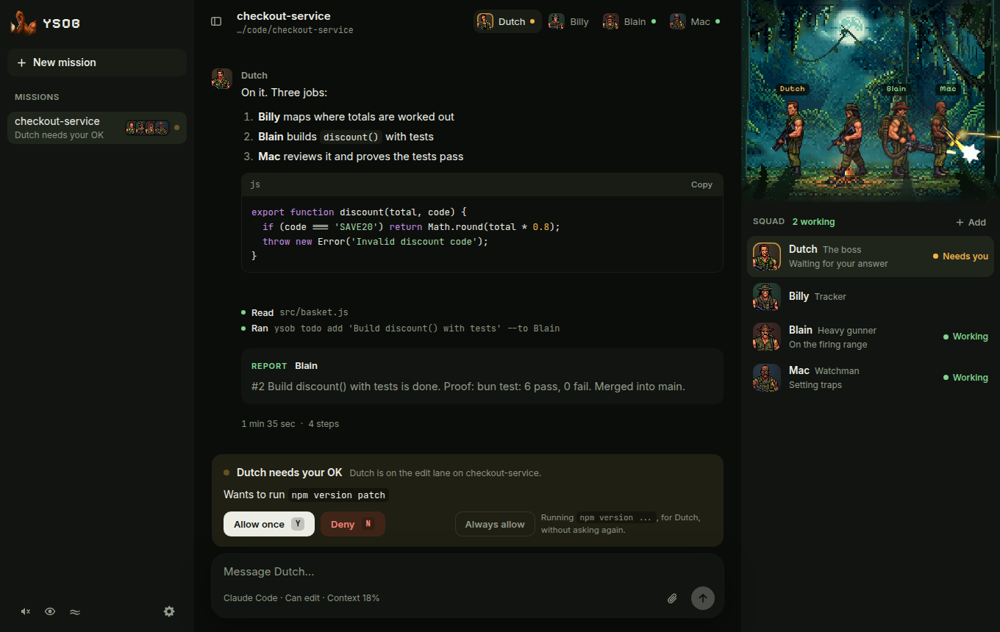
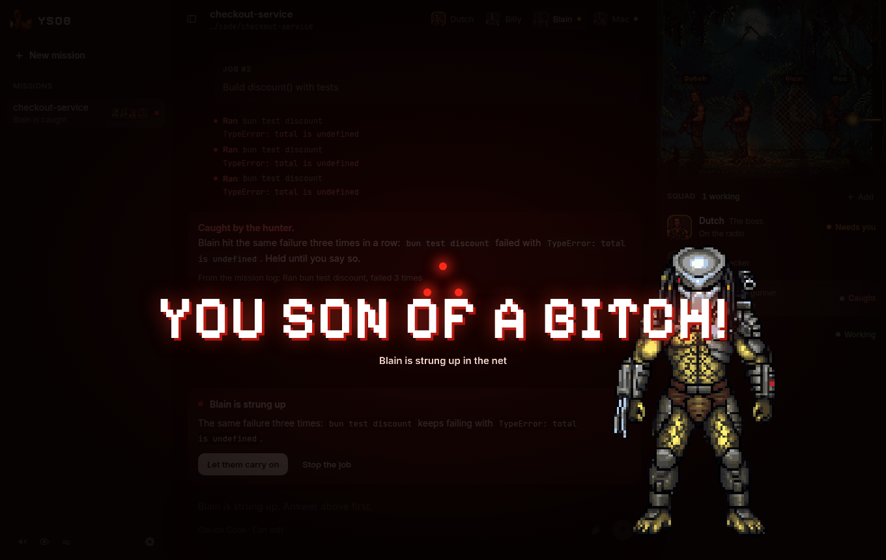

# You Son Of A Bitch (YSOB)

A free desktop app that runs a squad of AI coding agents on your own machine. You talk to the squad
leader. They do small jobs themselves and hand bigger ones to the squad: a scout who only reads, a builder,
a reviewer, a tester. Nothing counts as done without proof, and something in the trees hunts your bugs.



YSOB drives the agent CLIs you already use. It finds which are installed and signed in: Claude Code, Codex,
Gemini CLI, OpenCode, Cursor, Aider, Qwen Code, Amp, Goose, Copilot CLI, Kimi and Grok CLI. Claude Code
talks in the chat with every tool call checked. The others run in their own terminal inside the app.

No account. No telemetry. Your code goes to the agents you hire and nowhere else.

A fan-made toy for people who code with AI agents. Not affiliated with, or endorsed by, anyone who made the
film it nods to.

**[Download for Windows](https://releases.yousonofabitch.wtf/YSOB-setup.exe)** · **[Discord](https://yousonofabitch.wtf/discord)** · **[yousonofabitch.wtf](https://yousonofabitch.wtf)**

## Install

**Windows:** download the installer from https://releases.yousonofabitch.wtf/YSOB-setup.exe and run it.
It installs for your user only (no admin) and updates itself. The installer is not code-signed yet, so
Windows shows a warning first: choose "More info", then "Run anyway".

**Linux:** build from source (below). `bunx tauri build` makes a `.deb`, an `.rpm` and an AppImage.

**macOS:** not built or tested yet. The engine and the app run from source.

You also need at least one agent CLI installed and signed in. Claude Code gives you the most: chat, and
every tool call checked.

## Your first mission

1. Open YSOB. The first screen says which agents it found and whether the sandbox is on.
2. **Start a mission**: pick a project folder. A mission is one folder and the squad working in it.
3. Tell the squad leader what you want. They work, or split the job into todos for the squad.
4. When an agent wants to do something outside its lane, an ask docks above the box you type in.
   **Allow once** (Y), **Deny** (N), or **Always allow**, which says exactly what it would cover.
5. A job closes only with proof: the test run or check that shows it works.

Keys: Ctrl+K go to anything, Ctrl+N new mission, Ctrl+B missions, Ctrl+J squad, Ctrl+, settings,
T thermal vision, M mud mode (quiet), Y and N answer the first ask. On a Mac, Cmd for Ctrl.

## How it works

| Part | Where | What |
|---|---|---|
| Engine | `engine/` (Rust, the `ysob` program) | Runs the agents, the guard, the sandbox, the todo board |
| App | `ui/` (Svelte 5) | The chat, the squad, the asks, the big moments |
| Desktop | `desktop/` (Tauri v2) | A window around the engine, with updates and a folder picker |

- **Lanes.** Every squadmate has one. *Look*: read the mission, run look-only commands. *Edit*: also change
  files in the mission, run tests and read-only git. *Full*: any command. Anything outside a lane asks you.
  Settings lists every Always you have given, and takes it back.
- **The squad leader** splits work with `ysob todo add` (`--to <name>` for one squadmate), brings people on
  with `ysob squad add <name>` (never with full access) and hears each finished job back with its proof.
- **Own checkouts.** In a git repo each editing squadmate works in `.ysob/worktrees/<name>` on branch
  `ysob/<name>`. A job closed with proof is committed and merged into the main checkout. A clash stays on
  the branch for you or the squad leader.
- **No proof, no trophy.** `ysob todo done <id> --proof "..."` is the only way a job closes, and "done" or
  "it works" is not proof.
- **Three strikes.** The same failure three times and the agent is held until you let it carry on.

  

- **The lie detector.** An agent that says done while the last test run in that turn failed gets called out.
- **Budget.** A daily spend limit for Claude Code agents on an API key, from what they report. A Claude
  subscription costs nothing extra and isn't counted; terminal agents don't report costs. At zero every
  checked tool call is refused until you raise it (or you are only warned: your choice).

## Security model

An agent's own code (a test it writes, a build script) is treated as hostile.

- **The guard** (`engine/src/lanes.rs`) checks every Claude Code tool call against the agent's lane.
- **The sandbox** (`engine/src/sandbox.rs`, bubblewrap, Linux) is what a look or edit agent's processes can
  reach: the mission (read-only for look), a private home with only its engine's sign-in file, the system
  read-only. Not your home folder, `/run`, other projects or the engine's data. Git data and agent settings
  are read-only, and the environment is cleared down to an allowlist. Ubuntu 24.04 needs an AppArmor
  profile for `/usr/bin/bwrap`.
- **The engine's own git** (`engine/src/worktree.rs`) runs with hooks, fsmonitor and submodule recursion
  off, pinned to paths the engine worked out itself. Merges that touch agent settings, git metadata,
  symlinks or nested repos wait for you.
- **The app** renders agent output escape-first under a Content Security Policy. The desktop shell lets the
  page call six commands of its own (version, three for updates, the folder picker, open a web link in
  the browser) and nothing else.
- **Updates** are signed. The app only installs one that verifies against the key it was built with, over HTTPS.

Known limits:

- Windows and macOS have no sandbox yet: the guard only, and nothing contains an agent's own code.
- Engines other than Claude Code are sandboxed on Linux, but their tool calls are not checked one by one.
  They ask in their own terminal.
- Agents need the network for their model, so code in the sandbox can reach the internet and loopback
  services, and can send the mission's own files out.
- The engine's sign-in file is shared read-write so token refreshes work, so an agent's code can read that token.
- A full-access squadmate runs outside the sandbox.

To report a security problem, see [SECURITY.md](SECURITY.md).

## Build from source

Needs Rust (stable) and [Bun](https://bun.sh). Linux sandboxing needs `bubblewrap`.

```bash
(cd ui && bun install && bun run build)
cargo build --release
./target/release/ysob serve --ui ui/dist      # prints http://127.0.0.1:7799/#token=...
```

Desktop app: `cd desktop && bun install && bunx tauri build` (it builds the UI and the engine first).
A build made this way doesn't update itself. To make one that does, set `YSOB_UPDATE_URL` (the address of
your `latest.json`, HTTPS) and `YSOB_UPDATE_PUBKEY` (your updater public key) when you build.

Tests: `cargo test --release` (99 on Linux: the guard, the sandbox, attacks on the engine's git, end to end),
`cd ui && bunx svelte-check --no-tsconfig && bun test src/lib`.

## Theme packs

Everything themed is a pack: who the squad are, what they look like, what the big moments say and sound
like. The app always has one: `packs/default`, original art, ships with every build. Put your own in `ui/public/packs/jungle/` before you build and it is used instead. Packs are never
committed (that folder is ignored by git).

A pack is a folder with a `pack.json`. Every part is optional: what a pack leaves out falls back to the
built-in words, a silhouette or a synthesised sound.

```json
{
  "name": "my-pack",
  "roster": [
    { "name": "Chief", "slug": "chief", "job": "Squad leader", "does": "Plans the mission and gives the orders",
      "lane": "WRITE", "hue": 32, "boss": true },
    { "name": "Scout", "slug": "scout", "job": "Recon", "does": "Reads the code and finds things first",
      "lane": "READ", "hue": 150 }
  ],
  "words": { "lie.line": "LIAR!", "done.kicker": "Job proven" },
  "crew": {
    "scout": {
      "portrait": "crew/scout.png",
      "anchor": { "head": [0.47, 0.03, 0.94] },
      "anims": {
        "idle": { "sheet": "sprites/scout_idle.png", "frames": 9, "w": 172, "h": 172, "ms": 110, "anchor": [0.49, 0.85] },
        "fire": { "sheet": "sprites/scout_fire.png", "frames": 9, "w": 172, "h": 172, "ms": 110, "anchor": [0.49, 0.85], "muzzle": [0.87, 0.4] }
      }
    }
  },
  "hunter": { "portrait": "crew/hunter.png", "anims": { "idle": { "sheet": "sprites/hunter_idle.png", "frames": 9, "w": 176, "h": 176, "ms": 110 } } },
  "sounds": { "join": "sounds/join.mp3", "strike": "sounds/strike.mp3" },
  "scenes": { "panel": "scenes/panel.png", "thermal": "scenes/thermal.png" },
  "handshake": "icon/handshake.png"
}
```

- **roster**: the squad. `name` is what the agent is called (letters, numbers, spaces, hyphens, up to 24).
  `slug` is its key under `crew`. `lane` is `READ`, `WRITE` or `HOST` when you add them yourself; the squad
  leader can bring them on with edit access at most. One entry has `"boss": true`.
- **words**: any of the strings in [`ui/src/lib/words.js`](ui/src/lib/words.js), by key. `{name}`, `{boss}`
  and `{mission}` are filled in.
- **crew**: per squadmate, a `portrait` (a square picture, used for faces) and `anims`. Each animation is a
  sprite sheet: square frames in one row, drawn **side-on, facing right** (the app mirrors them). `idle` and
  `fire` are the ones that matter; `walk`, `death`, `hurt` and `attack` are used when present. `anchor` is
  where the character stands in a frame (centre of the feet, ground line) as fractions, so poses line up.
  `muzzle` is where the gun's flash is. `anchor.head` (centre, top, body height) frames the face.
- **hunter**: a `portrait` for the big moment and an `idle` sheet for sightings in the trees.
- **sounds**: clips by event: `join`, `strike`, `roar`, `lie`, `purr`, `snarl`, `cloak`, `clicks`, `pass`,
  `done`, `done_line`, `destruct`, `thermal`. Anything missing is synthesised or silent.
- **scenes**: `panel` is the squad's backdrop (2:1, pixel art), `thermal` its heat-vision twin.
- **handshake**: the picture on the splash screen, shown at 208 px.

Only use art and sound you have the rights to.

## Community

Help, ideas, bugs and every new version: **[Discord](https://yousonofabitch.wtf/discord)**. Bugs and pull
requests are welcome here too.

## Contributing

See [CONTRIBUTING.md](CONTRIBUTING.md).

## Licence

MIT. See [LICENSE](LICENSE). The original art in `packs/default` and `ui/public/heli` is free to use under the same licence.
